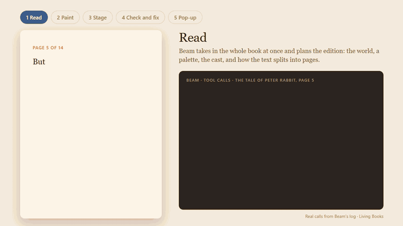
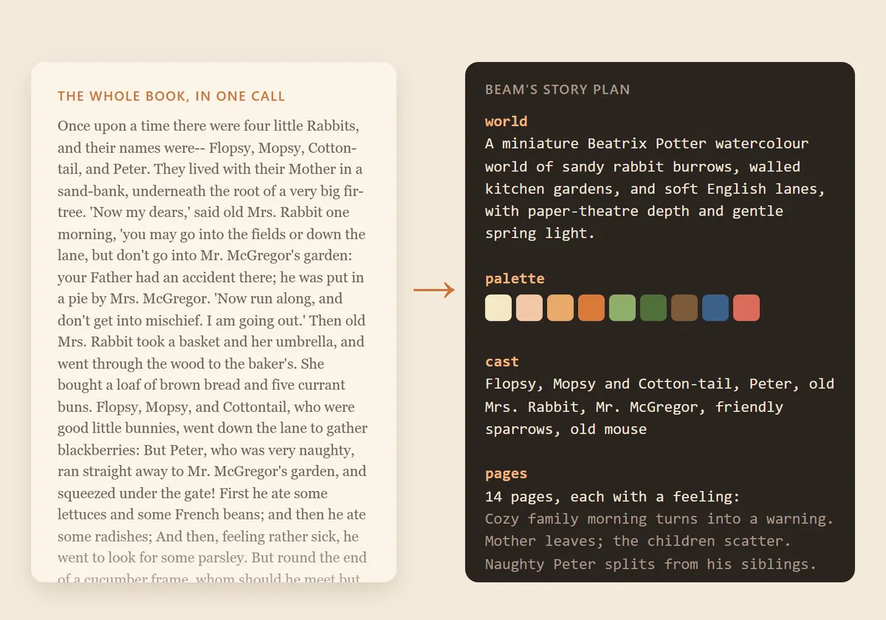
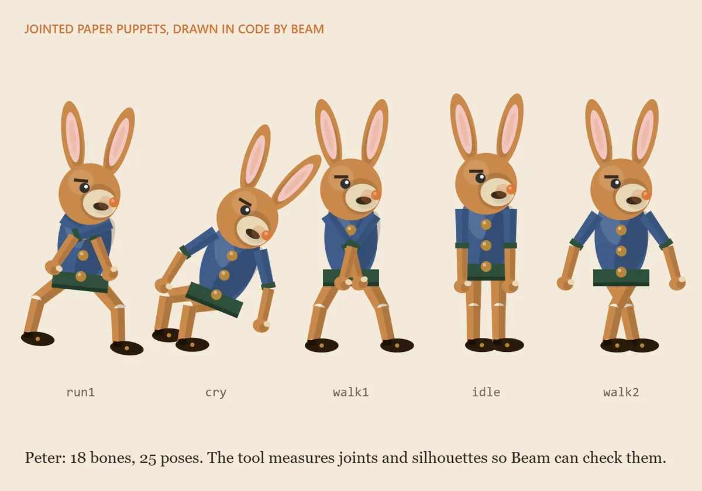
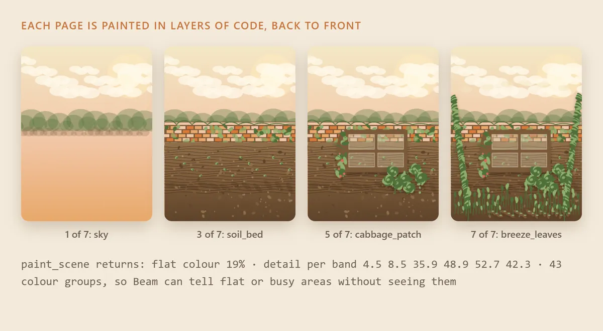
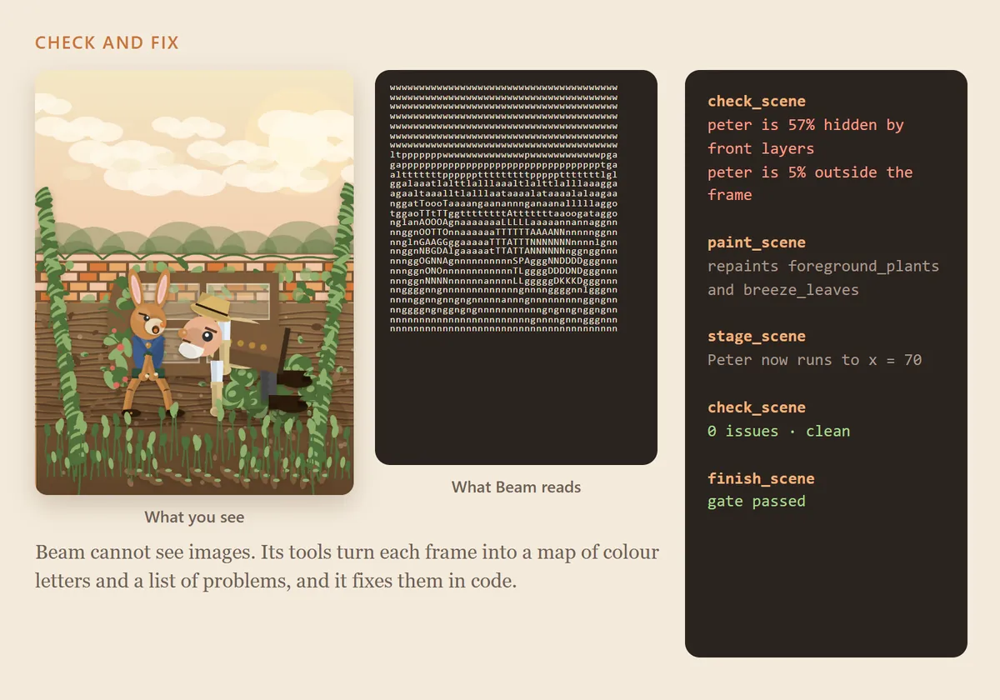
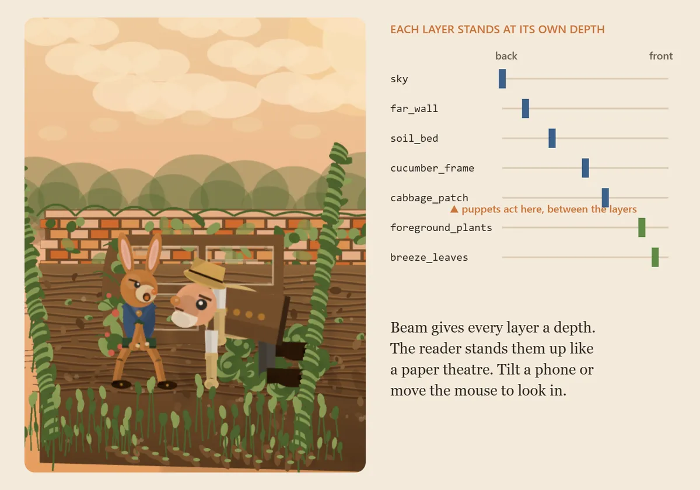

# Living Books: classic stories, reflected by Beam

Whole classic books as living paper pop-ups. [Beam](https://developers.reflection.ai/) reads each complete book, designs every character as a jointed paper puppet, paints each page's world in code, stages the scene against the words, and fixes what its checking tools report. Every step goes through tool calls.

**▶ Try it: [living-books.mikacend.xyz](https://living-books.mikacend.xyz)** · [Hugging Face Space](https://huggingface.co/spaces/0xmika/living-books) · [Data and transcripts](https://huggingface.co/datasets/0xmika/living-books-data) · [80-second video](https://huggingface.co/spaces/0xmika/living-books/resolve/main/demo.mp4)



*Real calls from Beam's log for page 5 of The Tale of Peter Rabbit.*

| Book | Pages | Pass the scene check | Beam calls | Tokens Beam wrote | Fix rounds after a check |
|---|---|---|---|---|---|
| *The Tale of Peter Rabbit* (Beatrix Potter, 1902), plus a mini-game Beam wrote | 14 | 14 | 350 | 752K | 71 |
| *The Happy Prince* (Oscar Wilde, 1888) | 19 | 19 | 320 | 768K | 78 |

**Unofficial.** Built with Beam by Reflection AI for the Build with Beam challenge. Not a product of Reflection AI or Hugging Face.

---

## 1. Try it (nothing to install)

Open **[living-books.mikacend.xyz](https://living-books.mikacend.xyz)** on a phone or computer.

- Pick a book, then swipe or use the arrow keys to turn pages. Tilt the phone or move the mouse to look into the pop-up.
- Tap the **ⓘ** button on any page to see the real tool calls Beam made for that page.
- **Watch Beam read** replays a whole book's production from the transcripts.
- After the last page of *Peter Rabbit*, play **Home Before Dark**, the game Beam wrote.

## 2. Run it locally (1 minute, no key, no build)

The reader is a static site. You need Python 3 only.

```bash
git clone https://github.com/mikaelaldy/living-books.git
cd living-books
python -m http.server 8123 -d site
```

Open <http://localhost:8123>. Everything Beam made is already in `site/data/`.

## 3. Test it (no API key)

`pipeline/verify.py` loads every published page into the puppet engine in headless Chrome and runs the same scene check Beam had to pass. It exits with an error if any page fails.

```bash
pip install -r requirements.txt
python -m playwright install chromium
python -X utf8 pipeline/verify.py
```

Expected ending: `33 of 33 pages pass the scene check.`

The check reports actors outside the frame, feet off the ground, characters overlapping or hidden behind front layers, puppets that are too small, flat or empty areas, and drawing errors. To time the reader on a phone-sized screen with a slowed CPU, run `python -X utf8 pipeline/perf.py http://localhost:8123/read.html 5` while the local server runs.

## 4. Make a book with Beam (replicate the pipeline)

You need a Reflection API key from [platform.reflection.ai](https://platform.reflection.ai/api-keys), or a Hugging Face token with Inference Providers access (set `LB_ROUTE=hf`). One book of 14 to 19 pages took about 320 to 350 calls and 750K output tokens.

Keep the key in a file outside the repository. The scripts read it from the path in `LB_KEY`.

```bash
export LB_KEY=~/keys/reflection.txt          # file containing only the key
export LB_BOOK=books/texts/peter-rabbit.txt  # text between *** START OF ... *** and *** END OF ... ***
export LB_SLUG=my-peter-rabbit               # output goes to books/<slug>/
# export LB_ROUTE=hf                         # optional: Beam through Hugging Face

python -X utf8 pipeline/produce.py read    # Beam reads the whole book and writes bible.json (plan, cast, pages)
python -X utf8 pipeline/produce.py cast    # Beam designs every character with define_character
python -X utf8 pipeline/produce.py pages   # Beam paints, stages and checks every page, 4 at a time
python -X utf8 pipeline/produce.py page 5 "Peter should be in front of the cucumber frame"   # optional: redo a page with a note
python -X utf8 pipeline/export.py my-peter-rabbit "The Tale of Peter Rabbit" "Beatrix Potter"
python -X utf8 pipeline/verify.py my-peter-rabbit
```

Then open `http://localhost:8123/read.html?book=my-peter-rabbit`. On Windows PowerShell, set variables with `$env:LB_KEY = "C:\keys\reflection.txt"`.

Optional per-book files in `books/<slug>/`: `cast-brief.txt` gives a style and pose guide for casting, and `art-note.txt` gives an art direction note for every page. `produce.py sheet` renders every character in every pose to `cast-sheet.png`, for a visual review. `python -X utf8 pipeline/build_site.py` builds the minified production site into `dist/web`.

Every call is logged to `books/<slug>/logs/*.jsonl`, including Beam's reasoning, so `export.py` can build the replay pages from the real record.

## How it works

| | |
|---|---|
|  | **1. Read the whole book.** Beam takes in the complete text in one call and writes a story plan: the world, a palette, the cast, and a feeling for every page. |
|  | **2. Design the characters.** Each character is a jointed paper puppet: bones, drawing code and named poses, all written by Beam. The tool measures joints and outlines so Beam can check them. |
|  | **3. Paint the page in layers.** Beam paints each page as layers of Canvas code, back to front. The tool answers with numbers: how flat or busy each band of the picture is. |
|  | **4. Check and fix, without eyes.** Beam cannot see images. A checker turns each frame into a map of colour letters and a list of problems. Beam fixes them in code, and `finish_scene` refuses the page while issues remain. |
|  | **5. Stand it up as a pop-up.** Every layer has a depth, so the reader stands the page up like a paper theatre in WebGL, with the puppets acting between the layers. |

### Tools Beam calls

| Tool | What Beam sends | What comes back |
|---|---|---|
| `define_character` | bones with drawing code, named poses | joint gaps, pose bounds, a letter-map silhouette |
| `paint_scene` | depth-sorted layers of drawing code, ground line, anchors | colour statistics, detail per band, a letter map of the frame |
| `stage_scene` | a timeline of beats tied to phrases of the text | errors such as unknown poses or anchors |
| `check_scene` | up to 3 times to look at | issues, per-actor measurements every second, letter maps |
| `finish_scene` | a title and a director's note | accepted only if the check is clean |

### Notes on using Beam's API

These cost us time, so they may save you some:

- Set `reasoning_effort` on every call. The account default is `max`, which is slow for small steps. We used `xhigh` for casting and painting and `high` for staging.
- Send `reasoning_content` back on every assistant message in a tool loop, as Beam requires.
- Declare every field in tool schemas. Object properties that are not declared arrive empty, and keyed objects with nested properties can arrive flattened, so use arrays of objects with an `id` field.
- If a tool call's arguments are not valid JSON, replace them with `{}` in the history before the next call, or the next request can fail with `prompt_rendering_failed`.
- Treat `finish_reason: length` as a failed call, and stop a loop when the same error repeats.

## Repository map

| Path | What it is |
|---|---|
| `engine/engine.js` | The puppet engine: rigs, layers, timeline, the scene check and the letter maps. Copied to `site/engine.js`. |
| `pipeline/produce.py` | The production loop that drives Beam through the tools. |
| `pipeline/export.py` | Turns a produced book into site data, the replay and a scorecard. |
| `pipeline/verify.py` | Key-free test: re-runs the scene check on every published page. |
| `pipeline/build_site.py`, `package.py` | Production build for Cloudflare Pages and Hugging Face. |
| `pipeline/make_game.py`, `fix_game.py` | Beam writes, then revises, the *Peter Rabbit* game. |
| `pipeline/make_assets.py`, `make_howto.py`, `make_steps.py`, `make_video.py` | Render the landing video, the how-it-works clip, the step images and the demo video from Beam's real scenes and the live site. |
| `site/` | The reader (`read.html`), landing page, replay (`watch.html`), the game, and all book data. |
| `books/<slug>/` | Beam's story plan, cast, pages, review notes and full call logs. |
| `books/texts/` | The public-domain source texts, from Project Gutenberg (#14838 and #902). |

## Who did what

- **Beam** wrote the story plans, the characters and their poses, every background, every animation timeline and the game, and made every fix.
- **A coding agent** wrote the puppet engine, the pipeline, the reader and these pages. It did not edit Beam's art.
- **Visual review.** Beam cannot see images, so a third-party multimodal model looked at frames of each page and wrote review notes. Any model with image input, or a person, can fill this role. The notes are recorded in the logs and labelled on the replay pages.
- The scene check measures geometry. It cannot judge storytelling, so some pages still have weak staging.

## License

Code: Apache-2.0 (see `LICENSE`). Beam's generated data: CC-BY-4.0. Book texts: public domain, from Project Gutenberg. Three.js in `site/vendor/`: MIT. The reader keeps no accounts, cookies or analytics.
